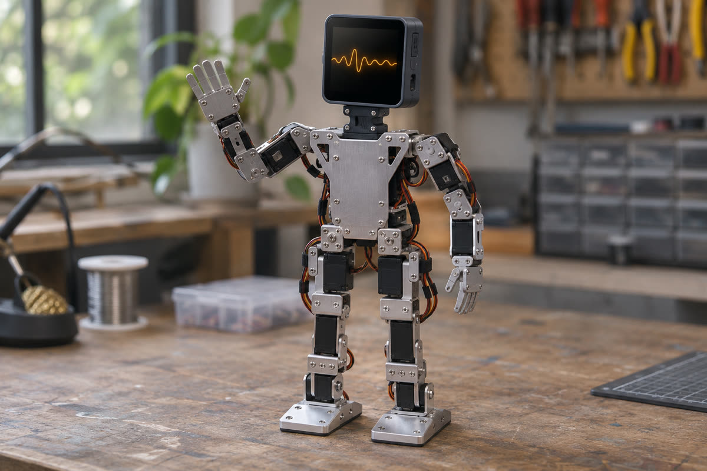
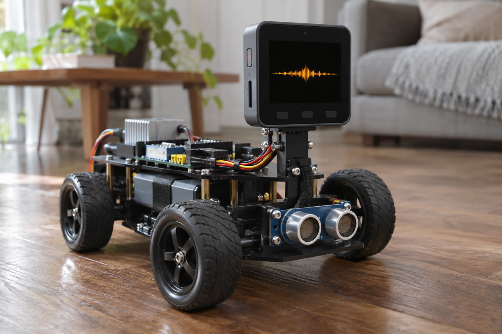
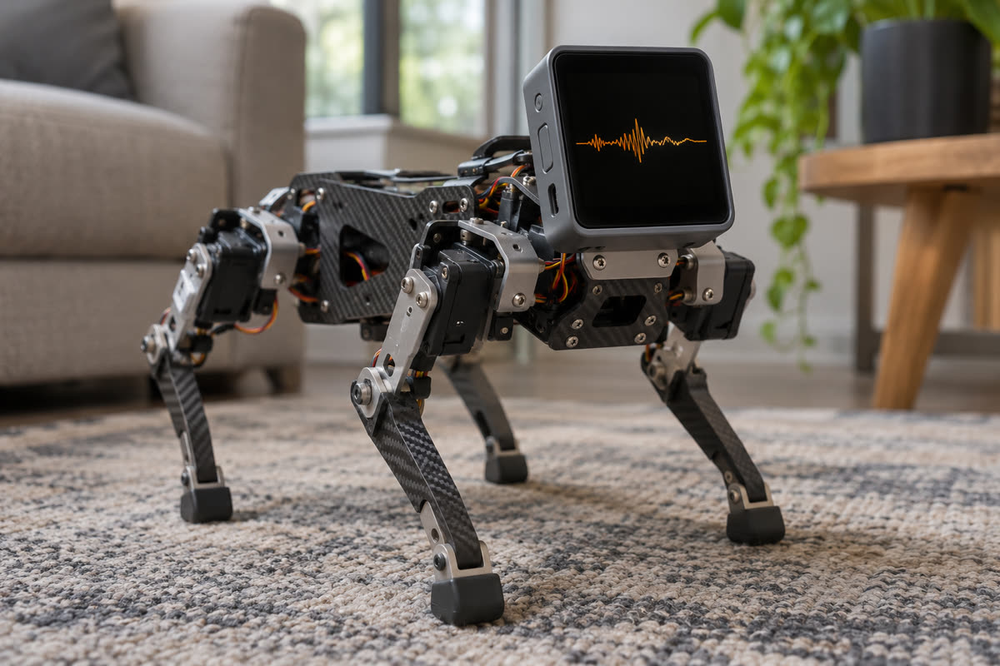
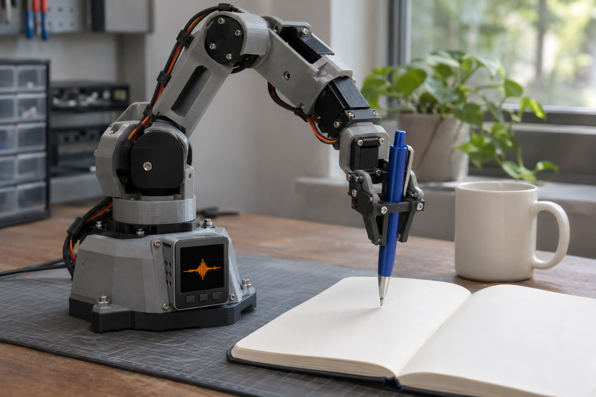
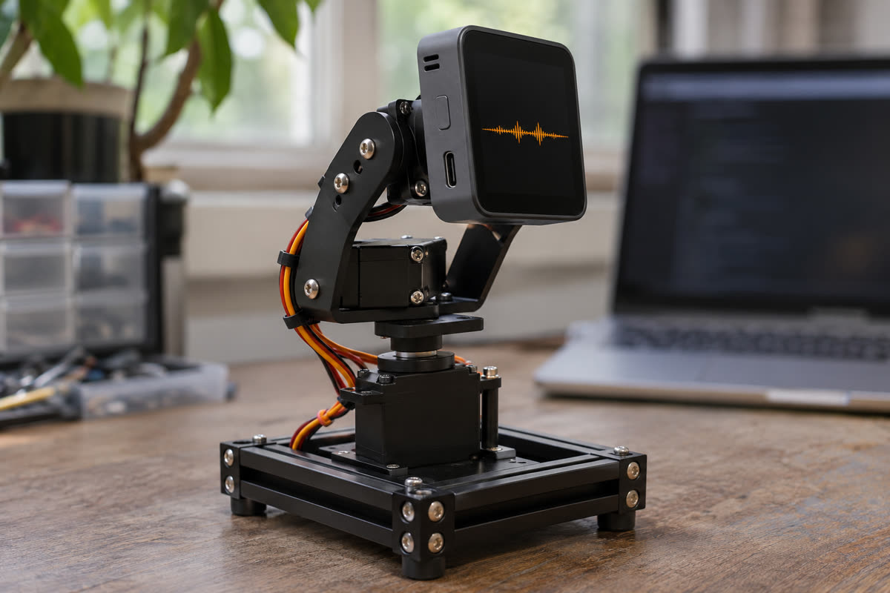
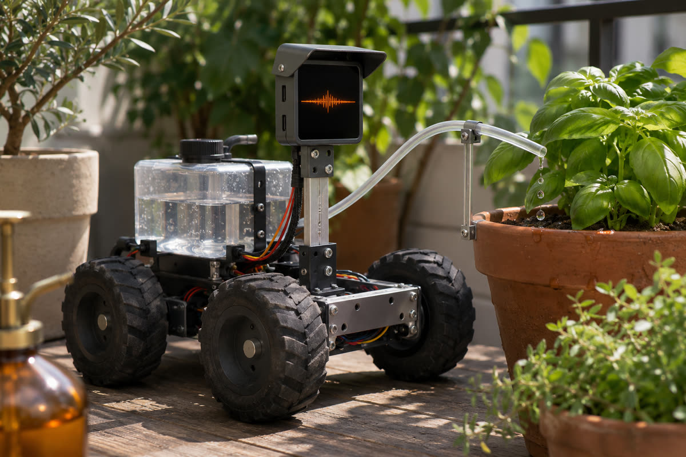

# Ideias: a CoreS3 Lite como cabeça de outros robôs

**São ideias, nada disto foi construído.** O robô deste projeto é de mesa e não se mexe (DEFINICAO.md). Aqui está o
que dá para criar quando ele vira a **cabeça e o rosto** de um corpo que anda, gira ou faz tarefas físicas.
Pedido do Nei, 15/11/2026: "ter ele como o rosto de um personagem que pode andar ou rodar: um robô, humanoide, um
carro ou um animal integrado, e ele se comunica com a IA e com o robô que tem outros recursos, principalmente de
locomoção ou de tarefas físicas". As imagens são ilustrações geradas pelo Codex, não fotos de protótipos.

## A ideia em uma frase

A CoreS3 Lite ouve, fala, vê e mostra; a IA entende e decide; o corpo anda, gira e pega, e cuida da própria segurança.

```
 você fala ──▶ CoreS3 Lite (cabeça)  ──Wi-Fi──▶  servidor no PC (Whisper → Claude → voz)
               ouve · fala · vê · mostra           entende o pedido e devolve:
                      ▲                              1) o que dizer   2) um comando simples
                      │ resposta falada                    │
                      │                                    ▼
                      └──────── fio Grove (I²C/serial) ou Wi-Fi ────────▶  corpo (controlador próprio)
                                "anda 30 cm", "gira 90°", "pega"           motores, servos, sensores
                                                                           para sozinho se algo der errado
```

## Como as três partes conversam

| Parte | Faz | Não faz |
|---|---|---|
| **Cabeça** (CoreS3 Lite) | Ouve, fala, mostra o rosto e a legenda, tira a foto, manda o pedido ao servidor e repassa o comando ao corpo | Não controla motor diretamente: tem uma porta Grove só |
| **Cérebro** (servidor no PC) | Transcreve, pede ao Claude a resposta **e um comando de uma lista fechada** (ex.: `andar`, `girar`, `pegar`, `parar`), confere o comando e devolve | Não executa nada na máquina: o Claude continua sem ferramentas |
| **Corpo** (controlador do kit) | Executa o comando, mede distância, **para sozinho** antes de bater ou se perder o contato | Não precisa entender fala nem imagem |

**Três cuidados que valem para todos os exemplos:**
1. **Lista fechada de comandos.** O Claude só escolhe entre ações conhecidas, com limites (ex.: andar no máximo 50 cm
   por vez). O servidor descarta qualquer coisa fora da lista. Fala transcrita nunca vira código.
2. **Segurança no corpo, não na IA.** Sensor de distância e parada automática ficam no controlador do kit. A IA
   demora segundos; o freio tem de agir em milissegundos.
3. **Energia do corpo.** A bateria da Lite (200 mAh) não aguenta andar por aí: a cabeça se alimenta pela bateria do
   kit, pelo USB-C.

Limites já medidos e conhecidos (FAQ.md): a resposta leva uns 7 a 8 s, então a IA decide o **rumo**, não dirige em
tempo real; a câmera não mede distância; fora do Wi-Fi de casa a opção B não funciona.

## Os 6 exemplos

### 1. Humanoide de oficina



Um humanoide de uns 35 cm, feito de servos e chapas de alumínio, com a CoreS3 Lite no lugar da cabeça.
**Você diz:** "acena para a visita" ou "mostra como se faz um agachamento". **A IA** escolhe um movimento gravado
(acenar, curvar, apontar, dançar) e diz uma frase junto. **O corpo** toca a sequência de servos. Bom para aula e
apresentação: o personagem fala, olha para quem pergunta e faz o gesto. Andar de verdade, com equilíbrio, é a parte
difícil e fica para depois; os gestos parados já rendem muito.

### 2. Carrinho que acompanha você



Um carrinho de 4 rodas com a cabeça num mastro e um sensor de distância no para-choque.
**Você diz:** "vem comigo" ou "vai ver se a porta da sala está aberta". **A cabeça** detecta seu rosto e manda o
carrinho girar para mantê-lo no centro (isso roda na placa, rápido). **A IA** cuida do pedido longo: tira uma foto
a cada poucos segundos e escolhe o rumo. **O corpo** anda e freia sozinho perto de obstáculos.
É o mais fácil de começar: kits de carrinho são baratos e já vêm com controlador.

### 3. Cão-robô



Um quadrúpede de uns 30 cm, de servos e fibra de carbono, com a cabeça na frente do corpo.
**Você diz:** "senta", "dá a pata", "vem cá". **A IA** transforma o pedido num dos movimentos do kit e responde com
voz e com a onda na tela. **A cabeça** reconhece quem é o "dono" pelo rosto e só obedece a ele, se você quiser.
**O corpo** já traz a caminhada pronta (os kits de cão-robô vêm com o andar programado).
É o que mais encanta crianças, e o personagem nasce sozinho.

### 4. Braço que te ajuda na mesa



Um braço de 6 eixos impresso em 3D, com a cabeça na base, virada para você.
**Você diz:** "me passa a caneta azul". **A IA** olha a foto, diz onde a caneta está ("à direita do caderno") e
escolhe o comando `pegar` com a posição. **O corpo** move o braço até lá e entrega. É o exemplo de **tarefa física**
mais útil, e o mais difícil: achar a posição exata do objeto pede calibrar a câmera com o braço. Combina com o projeto
do braço SO-101 que já existe na casa.

### 5. Cabeça que vira para quem fala



Uma base de dois servos (gira e inclina) com a cabeça no topo, em cima da mesa.
**Você** fala de qualquer lado da mesa. **A cabeça** acha seu rosto e a base gira para olhar para você; numa reunião,
ela vira para quem está falando. **A IA** continua a conversa como hoje. **O corpo** são só dois servos.
É o primeiro passo mais barato e mais seguro: dá vida ao robô de mesa sem tirá-lo da mesa.

### 6. Jardineiro de varanda



Um carrinho de rodas largas com um pequeno reservatório e uma bomba de água, com a cabeça num mastro.
**Você diz:** "rega o manjericão" ou "como estão as plantas?". **A IA** olha a foto de cada vaso e diz qual parece
seca. **O corpo** vai até o vaso marcado (com um QR code ou uma cor no chão) e liga a bomba por alguns segundos.
Mistura locomoção e tarefa física num lugar só. Água e eletrônica pedem caixa fechada; varanda precisa de Wi-Fi bom.

## Por onde começar

| Ordem | Exemplo | Por quê |
|---|---|---|
| 1 | Cabeça que vira (5) | Dois servos, sem risco, mostra a ideia da cabeça + corpo |
| 2 | Carrinho que acompanha (2) | Kit barato, já tem controlador, ensina a lista de comandos e o freio no corpo |
| 3 | Cão-robô (3) ou humanoide (1) | O personagem; movimentos já vêm prontos nos kits |
| 4 | Braço (4) ou jardineiro (6) | Tarefa física de verdade: pede calibração e mais cuidado |

O que muda no servidor para qualquer um deles: a persona ganha a lista de comandos do corpo, a resposta do Claude
passa a ter "o que dizer" + "um comando", e o servidor confere o comando antes de repassar. Nada disso está feito.
